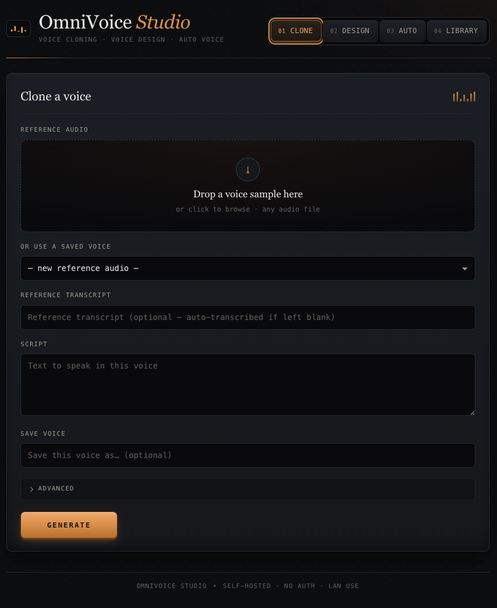
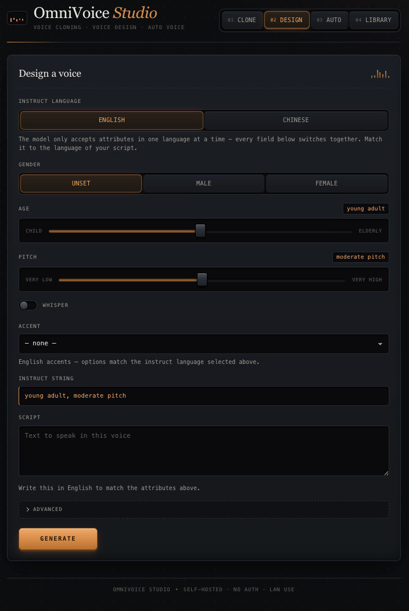
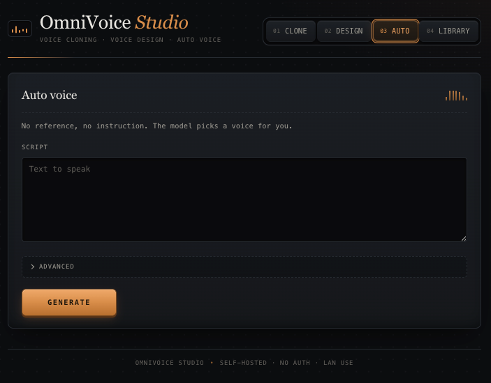
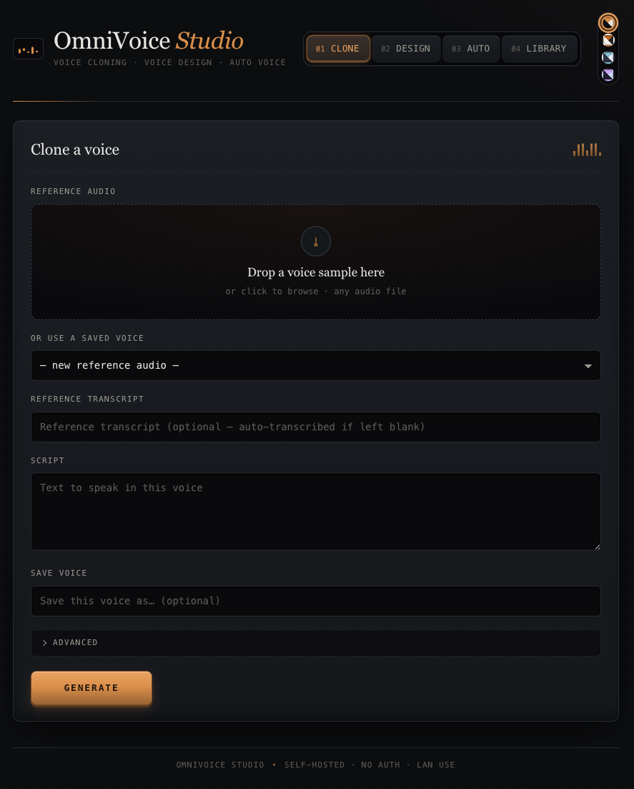
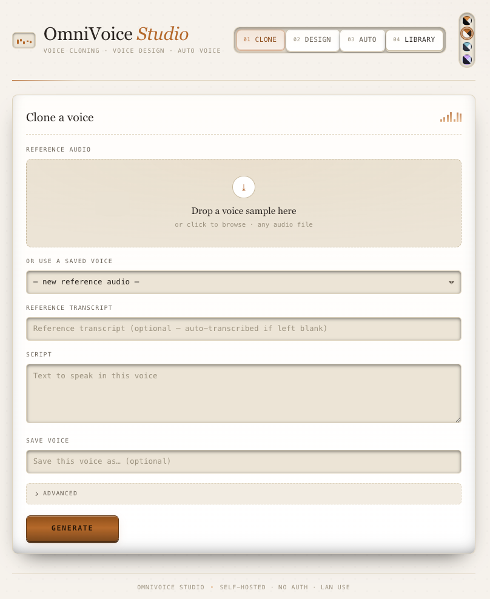
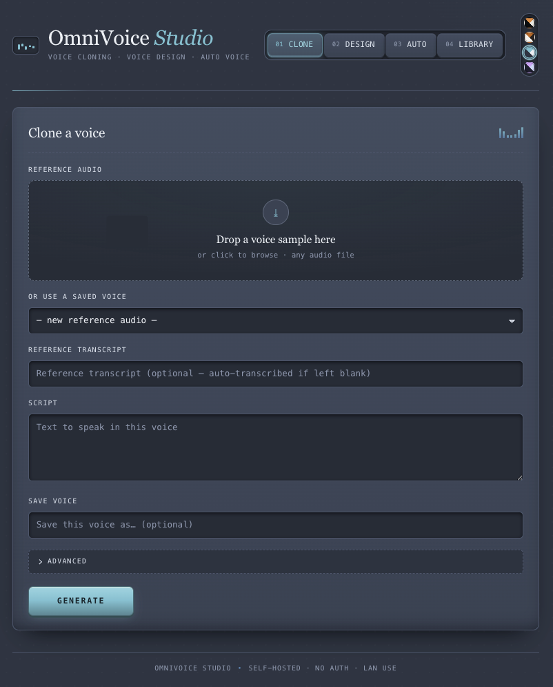
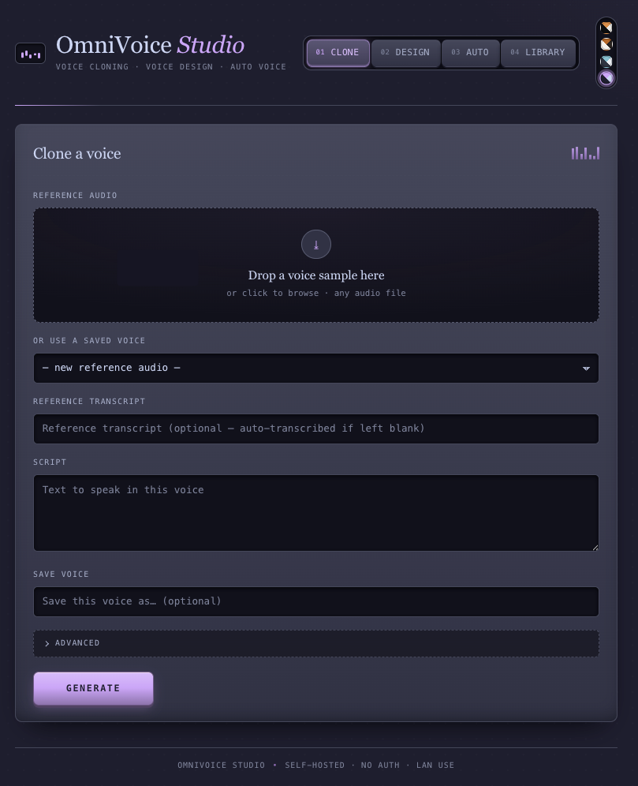

# 🎙️ OmniVoice Studio

A self-hosted web UI for [k2-fsa/OmniVoice](https://github.com/k2-fsa/OmniVoice) — voice cloning,
voice design, and auto voice, in a studio-style interface with four selectable themes.
FastAPI backend, plain-JS frontend, no build step, no framework.

> Unofficial, community-built. Not affiliated with or endorsed by the OmniVoice team.

| Clone | Design | Auto |
|---|---|---|
|  |  |  |

## Features

- **Voice cloning** — drag in a reference clip (auto-transcribed via Whisper if you skip the
  transcript), generate speech in that voice, and optionally save it as a **reusable voice**
  for later sessions without re-uploading.
- **Voice design** — describe a voice instead of cloning one: gender, age, pitch, whisper,
  and an accent (English) or dialect (Chinese). The instruct-language toggle keeps every
  attribute in the model's required single-language vocabulary, so you can't send an invalid
  combination.
- **Auto voice** — just text in, a voice picked for you.
- **Library** — every generation and saved voice lives in a history you can play, download,
  or delete.
- **No build step** — the frontend is plain HTML/CSS/ES6, no npm install, no bundler.
- Runs natively on **Apple Silicon (MPS)** for full acceleration, or in **Docker** (CPU) for
  portability.

## Themes

Dark Studio, Light, Nord, and Catppuccin (Mocha) — switch from the swatch stack in the header.
Your choice is remembered on this device.

| Dark Studio | Light |
|---|---|
|  |  |

| Nord | Catppuccin |
|---|---|
|  |  |

## Quickstart

### Native on macOS (recommended — MPS acceleration)

```bash
git clone https://github.com/tquizzle/omnivoice-studio.git
cd omnivoice-studio
python3 -m venv .venv && source .venv/bin/activate
pip install -r backend/requirements.txt
DATA_DIR=./data OMNIVOICE_DEVICE=mps uvicorn app.main:app --reload --app-dir backend --host 0.0.0.0 --port 8000
```

Open `http://localhost:8000`.

### Docker (CPU, portable)

```bash
cp .env.example .env
docker compose up -d
```

See [`backend/README.md`](backend/README.md) (carried over from the original build) for the
full `/api/generate` HTTP contract, configuration options, and troubleshooting.

## Why this exists

The official `omnivoice-demo` Gradio UI is great for a quick try, but doesn't persist saved
voices, keep a history, or offer a design-centric look at the voice-design attribute space.
This fills that gap for day-to-day/self-hosted use.

## Credits

Built on top of [k2-fsa/OmniVoice](https://github.com/k2-fsa/OmniVoice)
(Zhu et al., *OmniVoice: Towards Omnilingual Zero-Shot Text-to-Speech with Diffusion Language
Models*, arXiv:2604.00688). All model weights and inference code belong to that project —
this repo is just a web UI on top of its Python API.

## License

Apache License 2.0 — see [LICENSE](LICENSE).
